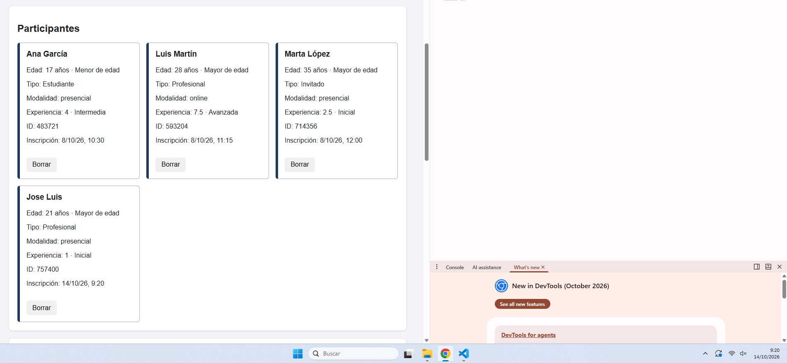

# Gestor de participantes de un evento

Práctica de DWEC ·

## Estructura

```text
index.html
estilos.css
logic.js
cookies.js
app.js
panel.html
panel.js
ayuda.html
ayuda.js
README.md
```

## Cómo ejecutar

La aplicación funciona solo con JavaScript del navegador y necesita servirse mediante HTTP.

Por ejemplo, desde la carpeta del proyecto se puede usar el servidor HTTP local de clase y abrir `index.html` desde `http://localhost:...`.

No se debe abrir con `file://` porque las cookies y la comunicación entre documentos se prueban con un origen HTTP.

## Funcionalidades

### Alta

- `app.js`: recoge los datos del formulario.
- `logic.js`: valida los datos con `validarParticipante()`.
- Se comprueban nombre, edad, tipo, modalidad y experiencia.
- Si hay errores, se conserva lo escrito y no se añade ningún participante.
- Al validar correctamente se genera un ID y una fecha ISO.

### Listado y bajas

- `crearTarjeta()` crea cada tarjeta con `createElement`, `textContent` y `append`.
- No se utiliza `innerHTML` para construir las tarjetas.
- El botón Borrar usa `confirm()` antes de modificar la colección.
- La búsqueda no distingue mayúsculas y minúsculas.
- Se puede filtrar por modalidad y combinar ambos filtros.

### Estadísticas

`calcularEstadisticas()` trabaja sobre la colección completa con bucles, contadores y acumuladores.

Se calculan total, menores, mayores, medias, extremos, modalidades, tipos y experiencia media presencial.
También se localiza el primer menor mediante `break`.

### JSON

- Exportar usa `JSON.stringify()`.
- Importar usa `JSON.parse()` dentro de `try/catch`.
- Antes de sustituir la colección se valida todo el array.
- Una importación incorrecta no modifica los datos actuales.

### Iframe y postMessage

`panel.html` se carga en un iframe.

`panel.js` instala primero el receptor y después avisa a la página principal con `postMessage`.

Los mensajes se comprueban mediante `origin`, `source` y los datos recibidos.

### Cookies

`cookies.js` contiene:

- `leerCookie()`
- `guardarCookie()`
- `borrarCookie()`

Las preferencias usan dos cookies independientes con `Path=/`, `SameSite=Lax` y `Max-Age` de 30 días.

### Ventana de ayuda

La página principal abre `ayuda.html` mediante `window.open()` y guarda su referencia para poder comprobar `closed` y cerrarla desde el botón correspondiente.

La página de ayuda muestra `navigator.language`, `location.origin` y las dimensiones de `screen`.

### Alta válida

1. Abrir la aplicación.
2. Introducir `Carlos`, `25`, `profesional`, `presencial`, `5`.
3. Pulsar Añadir participante.
4. Debe aparecer una nueva tarjeta y actualizarse las estadísticas.

### Alta inválida

1. Dejar el nombre vacío.
2. Introducir edad `18abc` o experiencia fuera de `0-10`.
3. Pulsar Añadir participante.
4. Debe aparecer un error y la colección no debe cambiar.

### Borrado

1. Pulsar Borrar en una tarjeta.
2. Cancelar el `confirm`.
3. La tarjeta debe seguir apareciendo.
4. Repetir y aceptar.
5. La tarjeta debe desaparecer y las estadísticas actualizarse.

### Búsqueda y filtro

1. Escribir parte de un nombre en Buscar.
2. Cambiar la modalidad.
3. Comprobar que ambos filtros se aplican a la vez.
4. Buscar un nombre inexistente y comprobar el mensaje de ausencia de coincidencias.

### Lista vacía

Borrar todos los participantes y comprobar que las estadísticas muestran `Sin datos` donde corresponde y el panel muestra `Sin inscripciones`.

### JSON válido

1. Pulsar Exportar JSON.
2. Modificar los datos si se desea.
3. Importar un array válido.
4. Deben actualizarse tarjetas, estadísticas y panel.

### JSON inválido

Introducir texto como `{ esto no es json` y pulsar Importar JSON. Debe aparecer un error y conservarse la colección anterior.

### Mensajes rechazados

Abrir DevTools y enviar mensajes desde la consola con un `origin` o `source` no esperado. El panel y la página principal deben ignorarlos.

### Cookies ausentes o alteradas

1. Borrar las cookies de preferencias.
2. Recargar y comprobar tema claro y tamaño normal.
3. Cambiar manualmente `dwec_tema` a un valor desconocido.
4. Recargar y comprobar que se usa el valor claro por defecto.

### Ventana de ayuda

Pulsar Abrir ayuda, comprobar la información del navegador y después pulsar Cerrar ayuda.
Si el navegador bloquea la apertura, debe mostrarse un aviso.

## Depuración y Network

Antes de entregar hay que realizar una captura real de DevTools con un punto de interrupción en una función del proyecto y otra captura de la pestaña Network mostrando una petición de la aplicación. Estas evidencias deben añadirse al README con una explicación breve.

## Uso de IA

La IA se ha utilizado como apoyo para consultar conceptos, revisar errores y comparar soluciones. Antes de entregar se deben conservar las consultas utilizadas y añadir el enlace accesible al chat indicado por la práctica.

**Enlace al chat:** 

## Evidencias pendientes de añadir

- CAPTURA 1 
